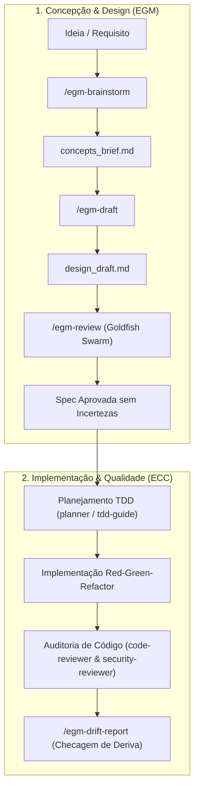

# ECC + EGM — Agent Instructions & Orchestration Guide

This project is powered by **ECC (Everything Claude Code / Developer Profile)** and **EGM (Elephant-Goldfish Model)** tailored for **Google Antigravity CLI (`agy`)**.

**ECC Version:** 2.2.3 (Profile: `developer`)  
**EGM Version:** 0.1.0 (Plugin: `.agents/plugins/egm/`)  
**Harness Target:** Antigravity Project (`.agents/`)

---

## 1. Core Principles

1. **Design First (EGM)** — Use deep-context brainstorming (`egm-brainstorm`) and draft specs (`egm-draft`), stress-testing them with zero-context subagents (`egm-review`) before writing code.
2. **Agent-First Delegation (ECC)** — Delegate distinct implementation and review tasks to specialized subagents (`planner`, `architect`, `code-reviewer`, `security-reviewer`, `tdd-guide`, etc.).
3. **Test-Driven Development (TDD)** — Always write tests first (RED), then minimal code to pass (GREEN), then refactor (REFACTOR). Require $\ge 80\%$ test coverage.
4. **Security-First** — Never hardcode secrets, API keys, or tokens. Validate all user inputs and sanitize data at boundaries.
5. **Immutability** — Favor immutable data structures and pure functions; avoid modifying state in-place.
6. **Clean Architecture & Small Files** — Keep functions focused (<50 lines) and files compact (typically 200–400 lines, max 800 lines).

---

## 2. Directory Layout & Customizations

Antigravity CLI discovers workspace customizations located under `.agents/`:

```text
.
├── .agents/
│   ├── agents/                   # ECC Specialized Subagents (.md)
│   ├── rules/                    # ECC Rules & Scoped Globs (.md)
│   ├── skills/                   # ECC Runbooks & Procedures (SKILL.md)
│   ├── workflows/                # ECC Workflows & Esteiras
│   ├── plugins/
│   │   └── egm/                  # EGM Plugin (plugin.json, skills/, agents/, resources/)
│   ├── plugins.json              # Workspace Plugin Registration
│   └── ecc-install-state.json    # ECC Integrity Manifest
├── AGENTS.md                     # Root Orchestration Instructions (this file)
├── EGM-ECC process.md            # Detailed Lifecycle Workflow Guide (Enterprise)
└── ... (Source Code)
```

---

## 3. Specialized Agents & Personas Catalog

All agents are accessible via `invoke_subagent` in fresh, isolated contexts or via the CLI (`agy agents`):

### 3.1. EGM Goldfish Reviewers (Zero-Context Design Audit)

| Agent | Purpose | Phase / When to Use |
| :--- | :--- | :--- |
| `egm-zoom-out` | High-altitude simplicity, minimalism, YAGNI, codebase reuse | Phase 1 & 4 of EGM Review |
| `egm-comprehension` | Naive reader, flags undefined terms, acronyms, mental jumps | Phase 2 of EGM Review |
| `egm-design` | Hostile critic on architecture, scalability, infrastructure economics, risks | Phase 3 of EGM Review |
| `egm-codebase-details` | Technical auditor verifying specs match actual code and reusable libraries | Phase 3 of EGM Review |
| `egm-style` | Copy editor for clarity, precision, brevity, objective framing | Phase 3 of EGM Review |
| `egm-structural` | Structural layout validator, hierarchy, formatting, template compliance | Phase 3 of EGM Review |
| `egm-implementation-readiness` | Tech lead verifying actionable steps without deferred design decisions | Phase 5 of EGM Review |
| `egm-synthesizer` | Aggregator coordinating goldfish passes and compiling reports | EGM review compilation |
| `egm-bootstrap-orchestrator` | Orchestrates directory READMEs and subtrees documentation | Documentation bootstrapping |

### 3.2. ECC Engineering Specialists

| Agent | Purpose | When to Delegate |
| :--- | :--- | :--- |
| [`planner`](.agents/agents/planner.md) | Feature decomposition & implementation planning | Complex tasks, architecture redesigns |
| [`architect`](.agents/agents/architect.md) | Distributed system design & scalability | High-level system decisions, tradeoffs |
| [`tdd-guide`](.agents/agents/tdd-guide.md) | Test-driven development enforcement | Writing new features, fixing regressions |
| [`code-reviewer`](.agents/agents/code-reviewer.md) | Static analysis & code quality | Immediately after any code edit |
| [`security-reviewer`](.agents/agents/security-reviewer.md) | OWASP & vulnerability scanning | Auth logic, secrets handling, input validation |
| [`build-error-resolver`](.agents/agents/build-error-resolver.md) | Build & compiler error resolution | Fix compilation, TypeScript or bundle failures |
| [`refactor-cleaner`](.agents/agents/refactor-cleaner.md) | Dead code cleanup & consolidation | Removing unused modules, safe refactoring |
| [`performance-optimizer`](.agents/agents/performance-optimizer.md) | Runtime bottleneck & memory profiling | Slow operations, high resource usage |
| [`database-reviewer`](.agents/agents/database-reviewer.md) | PostgreSQL / SQL query optimization | Schema migrations, indexing, slow queries |
| [`e2e-runner`](.agents/agents/e2e-runner.md) | End-to-end integration tests | Testing critical user journeys |
| [`doc-updater`](.agents/agents/doc-updater.md) | Architecture docs & codemaps | Syncing documentation with implementation |
| [`python-reviewer`](.agents/agents/python-reviewer.md) | Python PEP 8 & typing review | Python code changes |
| [`typescript-reviewer`](.agents/agents/typescript-reviewer.md) | TypeScript & Node.js code review | TypeScript / JavaScript changes |
| [`go-reviewer`](.agents/agents/go-reviewer.md) | Idiomatic Go patterns & concurrency | Go code changes |
| [`rust-reviewer`](.agents/agents/rust-reviewer.md) | Rust ownership & safety review | Rust code changes |

---

## 4. Integrated Lifecycle Workflow (EGM $\rightarrow$ ECC)



---

## 5. Skills Rápidas do EGM

Disponíveis como slash commands ou via prompt:

- `/egm-brainstorm <tópico>`: Concepção de ideia e alinhamento de premissas com revisores imparciais.
- `/egm-draft`: Redação guiada seção a seção do Design Doc técnico.
- `/egm-review <arquivo>`: Execução do Goldfish Review Protocol com subagentes isolados.
- `/egm-resolve`: Resolução e incorporação de apontamentos de revisão no documento.
- `/egm-drift-report`: Comparação do código implementado com o Design Doc aprovado.

---

## 6. Comandos de Manutenção

Execute no terminal dentro do repositório:

* **Auditoria de Plugins**: `agy plugin list`
* **Auditoria de Subagentes**: `agy agents`
* **Auditoria de Saúde ECC**: `npx ecc-universal doctor --target antigravity`
* **Reparo ECC**: `npx ecc-universal repair --target antigravity`
