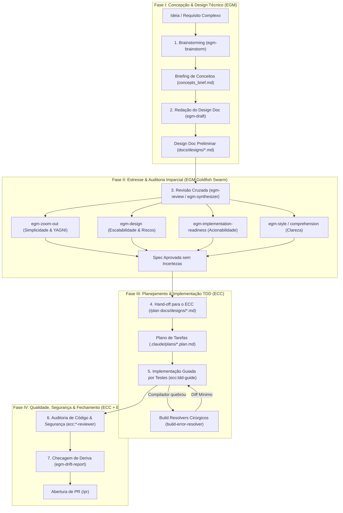

# Processo de Engenharia de Software Assistido por IA: EGM + ECC

Este documento descreve o fluxo de trabalho integrado unindo o **EGM (*Elephant-Goldfish Model*)** e o **ECC (*Everything Claude Code*)**. 

A integração desses dois frameworks combina a capacidade do **EGM** de conceber, rascunhar e estressar especificações arquiteturais com revisores imparciais de contexto limpo (*Goldfish*), com a potência do **ECC** de executar engenharia prática, desenvolvimento guiado por testes (TDD), cura cirúrgica de builds e auditoria técnica de código em 68 especialidades.

---

## 1. Visão Geral da Arquitetura Integrada



---

## 2. Por que Integrar EGM e ECC?

| Critério | EGM (*Elephant-Goldfish Model*) | ECC (*Everything Claude Code*) |
| :--- | :--- | :--- |
| **Ponto Forte** | Raciocínio arquitetural, desafio de premissas, design de sistemas e redação de especificações imunes a floreios. | Execução pragmática de código, conformidade de linguagem, esteiras SDLC automatizadas e testes de ponta a ponta. |
| **Mecanismo de Revisão** | **Zero-Context (*Goldfish*)**: Subagentes sem histórico que avaliam documentos como se fossem novos membros da equipe. | **Deep-Context & Heurísticas**: Especialistas que conhecem a stack, o runtime e as regras do repositório. |
| **Papel na Esteira** | Fases preliminares: da ideia ao *Design Doc* final aprovado. | Fases ativas: da quebra em tarefas ao código testado, auditado e enviado ao Git. |

---

## 3. Passo a Passo do Processo Integrado

---

### Passo 1: Ideação e Alinhamento Conceitual (EGM)
* **Objetivo**: Explorar o espaço do problema, elencar requisitos e descartar falsas soluções antes de pensar em código.
* **Ferramenta / Skill**: `egm-brainstorm`
* **Como Funciona**:
  1. O usuário aciona o brainstorming com o assistente principal (**o Elefante**).
  2. O Elefante conduz um diálogo desafiador: faz perguntas incômodas sobre *quem tem o problema*, *por que alternativas óbvias falham* e *quais restrições existem*.
  3. O modelo aplica diretrizes anti-adulação (*no glazing*): recusa elogios vazios, aponta fragilidades lógicas e exige consenso nos trade-offs fundamentais.
* **Artefato de Saída**: Um resumo de discussão ou briefing de conceitos (`concepts_brief.md`).

---

### Passo 2: Redação do Design Doc Técnico (EGM)
* **Objetivo**: Estruturar a solução técnica completa, contratos de interfaces, modelo de dados e lista de arquivos impactados.
* **Ferramenta / Skill**: `egm-draft`
* **Por que isenta o [`/plan-prd`](file:///home/willycornelissen/Desktop/Dablio/ecc/.agents/workflows/plan-prd.md) do ECC?**:
  O comando `/plan-prd` do ECC foca apenas no escopo abstrato de produto (*"o que fazer sem citar implementação"*). O `egm-draft` do EGM vai muito além: ele já consolida a proposta técnica de engenharia, arquitetura e lista de arquivos afetados em um único *Design Document* formal.
* **Como Funciona**:
  1. O Elefante lê o `concepts_brief.md` e monta iterativamente o documento em `docs/designs/<nome-da-feature>.md`.
  2. São descritos:
     * *Contexto e Motivação*;
     * *Objetivos e Não-Objetivos* (*Out of Scope*);
     * *Arquitetura Proposta e Diagramas de Sequência*;
     * *Contratos de API e Esquemas de Dados*;
     * *Seção de Implementação Detalhada*: lista exata de todos os arquivos a criar, modificar ou remover.
* **Artefato de Saída**: `docs/designs/<nome-da-feature>.md`.

---

### Passo 3: Fogo Cruzado e Revisão Imparcial com Subagentes Goldfish (EGM)
* **Objetivo**: Estressar o documento técnico com revisores independentes que **não participaram da conversa**, eliminando premissas ocultas e vieses.
* **Ferramenta / Agente**: `egm-review` orquestrado pelo [`egm-synthesizer`](file:///home/willycornelissen/.gemini/config/plugins/egm/agents/synthesizer.md).
* **Os Revisores Goldfish em Ação Paralela**:
  * [`egm-zoom-out`](file:///home/willycornelissen/.gemini/config/plugins/egm/agents/zoom_out.md): Desafia a complexidade. Questiona: *"Estamos construindo algo desnecessário? Isso viola YAGNI? Há bibliotecas prontas no projeto?"*
  * [`egm-design`](file:///home/willycornelissen/.gemini/config/plugins/egm/agents/design_critic.md): Procura riscos de concorrência, gargalos de infraestrutura, latência e falhas de escalabilidade.
  * [`egm-implementation-readiness`](file:///home/willycornelissen/.gemini/config/plugins/egm/agents/implementation_readiness.md): Atua como o desenvolvedor que vai codificar. Verifica se o plano deixa dúvidas em aberto ou se está 100% acionável.
  * [`egm-style`](file:///home/willycornelissen/.gemini/config/plugins/egm/agents/style.md) e [`egm-comprehension`](file:///home/willycornelissen/.gemini/config/plugins/egm/agents/comprehension.md): Removem prolixidade e clarificam termos obscuros.
* **Resultado**: O [`egm-synthesizer`](file:///home/willycornelissen/.gemini/config/plugins/egm/agents/synthesizer.md) agrupa os achados por criticidade (🔴 Blocker, 🟡 Major, 🟢 Nit). O usuário e o Elefante corrigem os pontos até que o documento obtenha veredicto de aprovação.

---

### Passo 4: Hand-off para o ECC — Planejamento Operacional
* **Objetivo**: Traduzir o Design Doc aprovado em um plano tático de execução de engenharia.
* **Ferramenta / Agente**: Comando `/plan` consumindo a especificação do EGM, acionando o [`planner`](file:///home/willycornelissen/Desktop/Dablio/ecc/.agents/agents/planner.md) do ECC:
  ```bash
  /plan docs/designs/<nome-da-feature>.md
  ```
* **Como Funciona**:
  1. O [`planner`](file:///home/willycornelissen/Desktop/Dablio/ecc/.agents/agents/planner.md) ingere o design doc aprovado.
  2. Como os arquivos e a lógica já foram estressados no EGM, o [`planner`](file:///home/willycornelissen/Desktop/Dablio/ecc/.agents/agents/planner.md) foca estritamente na **ordem cronológica de desenvolvimento**, quebra de testes e dependências imediatas.
* **Artefato de Saída**: `.claude/plans/<nome-da-feature>.plan.md`.

---

### Passo 5: Implementação Guiada por Testes (TDD) e Resolução de Builds (ECC)
* **Objetivo**: Escrever código robusto com garantia de cobertura e correção mecânica de falhas.
* **Ferramenta / Agente**: [`tdd-guide`](file:///home/willycornelissen/Desktop/Dablio/ecc/.agents/agents/tdd-guide.md) e o catálogo de *Build Resolvers*.
* **Como Funciona**:
  1. O desenvolvedor / assistente aciona o ciclo TDD:
     * **Red**: Escreve o teste unitário/integração que falha.
     * **Green**: Implementa o código mínimo estritamente necessário para passar no teste.
     * **Refactor**: Limpa o código mantendo os testes verdes.
  2. **Tratamento de Quebras**: Se o compilador, empacotador ou checagem de tipos acusar erro, o orquestrador aciona imediatamente o resolver cirúrgico correspondente:
     * Para erros de compilação web/TS: [`build-error-resolver`](file:///home/willycornelissen/Desktop/Dablio/ecc/.agents/agents/build-error-resolver.md) ou [`react-build-resolver`](file:///home/willycornelissen/Desktop/Dablio/ecc/.agents/agents/react-build-resolver.md).
     * Para erros em Go, Rust, Python, etc.: [`go-build-resolver`](file:///home/willycornelissen/Desktop/Dablio/ecc/.agents/agents/go-build-resolver.md), [`rust-build-resolver`](file:///home/willycornelissen/Desktop/Dablio/ecc/.agents/agents/rust-build-resolver.md), etc.
     * *Regra de Ouro*: O resolver aplica diffs mínimos cirúrgicos, sem refatorações oportunistas.

---

### Passo 6: Auditoria de Código, Segurança e Qualidade (ECC)
* **Objetivo**: Blindar o código contra vulnerabilidades, regressões e más práticas antes de gerar o pacote final.
* **Ferramentas / Agentes**:
  * **Revisores de Stack**:
    * [`typescript-reviewer`](file:///home/willycornelissen/Desktop/Dablio/ecc/.agents/agents/typescript-reviewer.md) para tipagem e async/await;
    * [`python-reviewer`](file:///home/willycornelissen/Desktop/Dablio/ecc/.agents/agents/python-reviewer.md) para PEP 8 e concorrência segura;
    * [`go-reviewer`](file:///home/willycornelissen/Desktop/Dablio/ecc/.agents/agents/go-reviewer.md), [`react-reviewer`](file:///home/willycornelissen/Desktop/Dablio/ecc/.agents/agents/react-reviewer.md), etc.
  * **Auditoria de Segurança Obrigatória**:
    * [`security-reviewer`](file:///home/willycornelissen/Desktop/Dablio/ecc/.agents/agents/security-reviewer.md) faz varredura OWASP Top 10, sanitização de inputs, validação de permissões (IDOR) e vazamento de segredos.
  * **Qualidade Complementar**:
    * [`silent-failure-hunter`](file:///home/willycornelissen/Desktop/Dablio/ecc/.agents/agents/silent-failure-hunter.md): detecta promessas engolidas e blocos `catch` vazios.
    * [`a11y-architect`](file:///home/willycornelissen/Desktop/Dablio/ecc/.agents/agents/a11y-architect.md): audita conformidade de acessibilidade (WCAG 2.2).

---

### Passo 7: Verificação de Deriva e Abertura de PR (EGM + ECC)
* **Objetivo**: Garantir que a implementação final correspondeu ao que foi originalmente desenhado e submeter a entrega.
* **Ferramentas**:
  1. **Relatório de Deriva (*Drift Report*) com EGM**:
     * Execute `egm-drift-report docs/designs/<nome-da-feature>.md`.
     * O subagente compara os arquivos modificados no Git com o que estava estipulado no Design Doc, alertando se novas rotas ou comportamentos não planejados foram introduzidos.
  2. **Entrega com o ECC**:
     * Execute o workflow `/pr`.
     * O ECC executa a suíte de testes final, valida o estado do Git e gera a descrição do Pull Request vinculando os commits ao design doc.

---

## 4. Matriz de Responsabilidades (RACI Integrada)

| Etapa do Processo | Principal Responsável | Suporte / Subagentes | Artefato Gerado |
| :--- | :--- | :--- | :--- |
| **Ideação & Requisitos** | Usuário + Elefante | `egm-brainstorm` | `concepts_brief.md` |
| **Arquitetura & Especificação** | Elefante | `egm-draft` | `docs/designs/*.md` |
| **Estresse & Desafio da Spec** | [`egm-synthesizer`](file:///home/willycornelissen/.gemini/config/plugins/egm/agents/synthesizer.md) | [`egm-design`](file:///home/willycornelissen/.gemini/config/plugins/egm/agents/design_critic.md), [`egm-zoom-out`](file:///home/willycornelissen/.gemini/config/plugins/egm/agents/zoom_out.md), [`egm-implementation-readiness`](file:///home/willycornelissen/.gemini/config/plugins/egm/agents/implementation_readiness.md) | Relatório de Veredito / Spec Final |
| **Plano Tático de Tarefas** | [`planner`](file:///home/willycornelissen/Desktop/Dablio/ecc/.agents/agents/planner.md) (ECC) | [`code-architect`](file:///home/willycornelissen/Desktop/Dablio/ecc/.agents/agents/code-architect.md) | `.claude/plans/*.plan.md` |
| **Codificação & Testes** | Desenvolvedor / Assistente | [`tdd-guide`](file:///home/willycornelissen/Desktop/Dablio/ecc/.agents/agents/tdd-guide.md), *Build Resolvers* | Código-fonte e testes ($\ge 80\%$ cobertura) |
| **Auditoria Técnica & OWASP** | [`security-reviewer`](file:///home/willycornelissen/Desktop/Dablio/ecc/.agents/agents/security-reviewer.md) | Revisor da linguagem (`*-reviewer`) | Scorecard de qualidade |
| **Conformidade com o Design** | `egm-drift-report` | Subagentes de leitura de diff | Relatório de paridade Design vs. Código |
| **Fechamento e Git** | Workflow `/pr` (ECC) | [`git-workflow`](file:///home/willycornelissen/Desktop/Dablio/ecc/.agents/skills/git-workflow/SKILL.md) | Pull Request finalizado |

---

## 5. Resumo das Regras de Convivência

1. **Separação Clara de Funções**:
   * O **EGM** governa o *quê*, o *porquê* e o *desenho arquitetural*;
   * O **ECC** governa o *código*, os *testes*, os *compiladores* e a *segurança*.
2. **Sem Retrabalho de PRD**:
   * Se a funcionalidade passou pelo ciclo de design do EGM, **não execute `/plan-prd`**. Alimente diretamente o `/plan` ou o `tdd-guide` com o documento gerado em `docs/designs/`.
3. **Isolamento de Contexto Mantido**:
   * O enxame Goldfish do EGM garante que a arquitetura não tenha viés antes de começar.
   * Os subagentes especialistas do ECC garantem que a implementação não quebre compilações e mantenha o padrão de produção.
