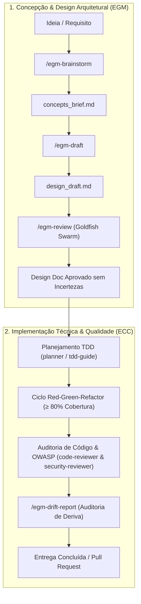

# Desenvolvimento Assistido por IA: ECC + EGM (Antigravity CLI)

Bem-vindo ao ambiente de desenvolvimento de software governado pela união do **ECC (*Everything Claude Code / Developer Profile*)** e do **EGM (*Elephant-Goldfish Model*)**, especificamente preparado e calibrado para o **Google Antigravity CLI (`agy`)**.

Este repositório combina o **EGM** (para concepção arquitetural profunda e auditoria estressada com subagentes em contexto limpo) com o **ECC** (para execução técnica pragmática, desenvolvimento guiado por testes - TDD, resolução cirúrgica de erros de compilação e auditoria de qualidade/segurança).

---

## 1. Visão Geral da Arquitetura

O ecossistema opera em duas frentes complementares e coordenadas:



---

## 2. Estrutura de Diretórios e Recursos Instalados

```text
.
├── .agents/
│   ├── agents/                   # 70+ Subagentes Especialistas do ECC (.md)
│   ├── rules/                    # Regras Normativas & Scoped Globs do ECC (.md)
│   ├── skills/                   # Runbooks e Procedimentos Modulares do ECC
│   ├── workflows/                # Esteiras de Automação do ECC
│   ├── plugins/
│   │   └── egm/                  # Plugin Nativo do EGM (versão 0.1.0)
│   │       ├── plugin.json       # Manifesto de Identidade do Plugin
│   │       ├── agents/           # 10 Subagentes e Personas Goldfish
│   │       ├── skills/           # 7 Skills do Fluxo EGM (brainstorm, draft, review...)
│   │       ├── resources/        # Padrões Heilmeier, padrões de specs e instruções
│   │       ├── docs/             # Guias de integração e referências
│   │       └── assets/           # Identidade visual e ícones
│   ├── plugins.json              # Registro de Descoberta de Plugins do Workspace
│   └── ecc-install-state.json    # Manifesto de Integridade e Auditoria do ECC
├── AGENTS.md                     # Diretrizes Globais de Orquestração para o Antigravity
├── EGM-ECC process.md            # Guia Detalhado do Ciclo de Vida da Engenharia (Enterprise)
├── quickstart.md                 # Guia Rápido de Especificação e Desenvolvimento Ágil (Fast-Track)
├── README.md                     # Documentação e Manual do Workspace (este arquivo)
└── .gitignore                    # Regras de Exclusão do Git
```

---

## 3. Catálogo de Recursos Disponíveis

### 3.1. Subagentes Especialistas

O ambiente disponibiliza mais de 80 subagentes executáveis em contextos isolados (*fresh context*) através da ferramenta nativa `invoke_subagent` ou listáveis via terminal com `agy agents`:

#### Personas Goldfish de Auditoria Arquitetural (EGM)
* **`egm-zoom-out`**: Avalia simplicidade em alto nível, minimalismo, conformidade com YAGNI e reuso de componentes.
* **`egm-comprehension`**: Persona de leitor ingênuo que detecta saltos lógicos, premissas implícitas, jargões e siglas sem definição.
* **`egm-design`**: Crítico hostil focado em escalabilidade, economia de infraestrutura, tolerância a falhas e riscos.
* **`egm-codebase-details`**: Auditor que valida se a especificação condiz com o código existente e oportunidades de reuso.
* **`egm-style`**: Editor de cópia técnica que remove floreios, adjetivos vagos (*seamless*, *robust*) e foca em concisão.
* **`egm-structural`**: Valida hierarquia visual, simetria de tópicos e conformidade com os padrões de documentos.
* **`egm-implementation-readiness`**: Tech lead que valida se o plano está 100% pronto para execução sem decisões de design adiadas.
* **`egm-inventive-catalyst`**: Solucionador inventivo de contradições técnicas aplicando princípios TRIZ.
* **`egm-synthesizer`**: Compilador que agrega e deduplica apontamentos das rodadas de revisão.
* **`egm-bootstrap-orchestrator`**: Mapeador de subárvores e documentador de contratos de pacotes.

#### Especialistas de Engenharia e Ciclo de Vida (ECC - Perfil `developer`)
* **Planejamento & Arquitetura**: `planner`, `architect`, `code-architect`, `code-explorer`.
* **Qualidade & TDD**: `tdd-guide`, `code-reviewer`, `code-simplifier`, `refactor-cleaner`, `comment-analyzer`.
* **Segurança & Banco de Dados**: `security-reviewer` (vulnerabilidades OWASP), `database-reviewer` (queries e migrações).
* **Cura de Compilação & Tipagem**: `build-error-resolver`, `react-build-resolver`, `go-build-resolver`, `cpp-build-resolver`, `java-build-resolver`, `kotlin-build-resolver`, `rust-build-resolver`, `swift-build-resolver`, `dart-build-resolver`.
* **Revisores Especializados de Stacks**: `typescript-reviewer`, `python-reviewer`, `go-reviewer`, `rust-reviewer`, `react-reviewer`, `vue-reviewer`, `fastapi-reviewer`, `django-reviewer`, `java-reviewer`, `flutter-reviewer`, `csharp-reviewer`, `php-reviewer`.
* **Testes de Integração & Performance**: `e2e-runner` (Playwright), `performance-optimizer`, `pr-test-analyzer`.

---

### 3.2. Skills e Comandos Rápidos

As habilidades estão prontas para ativação semântica ou via *slash commands*:

| Habilidade | Comando / Invocação | Descrição |
| :--- | :--- | :--- |
| **Brainstorming EGM** | `/egm-brainstorm <ideia>` | Discute requisitos e desafios conceituais; gera `concepts_brief.md`. |
| **Redação de Design Doc** | `/egm-draft` | Redige seção a seção o Design Doc com base no briefing (`design_draft.md`). |
| **Revisão Goldfish** | `/egm-review <doc>` | Executa a bateria de 5 fases de revisão com subagentes em contexto limpo. |
| **Resolução de Apontamentos** | `/egm-resolve` | Guia a resolução e incorporação dos feedbacks no documento. |
| **Checagem de Deriva** | `/egm-drift-report` | Compara o código implementado com o Design Doc aprovado. |
| **TDD Workflow** | *"Siga o tdd-workflow"* | Executa o ciclo Red-Green-Refactor com meta de $\ge 80\%$ de cobertura. |
| **Memória Unificada** | `npx ecc-universal memory` | Salva e recupera contexto compartilhado entre diferentes sessões e ferramentas. |
| **Auditoria de Qualidade** | *"Execute agent-self-evaluation"* | Emite nota técnica em 5 eixos (precisão, completude, clareza, etc.). |

---

## 4. Guia Prático de Utilização

### 4.1. Iniciando o Agente Antigravity

No terminal (WSL2 / Linux), navegue até a raiz deste projeto:

```bash
# Iniciar sessão padrão
agy

# Continuar a conversa anterior exatamente de onde parou
agy -c

# Iniciar já passando um prompt interativo
agy -i "Vamos conceber a arquitetura do novo módulo de autenticação"

# Execução pontual não-interativa (print mode)
agy -p "Rode a checagem de integridade com o ecc doctor"
```

---

### 4.2. Fluxo de Trabalho Recomendado: Da Ideia ao Commit

> [!TIP]
> **Aplicações Simples ou Utilitários?** Se você estiver construindo uma aplicação simples, script, CLI ou MVP que não exige o ciclo cerimonial completo de 7 passos do [`EGM-ECC process.md`](file:///home/willycornelissen/Desktop/Dablio/new-pp/EGM-ECC%20process.md), consulte o [`quickstart.md`](file:///home/willycornelissen/Desktop/Dablio/new-pp/quickstart.md) para o processo ágil de especificação direta e entrega em 4 passos.

#### Passo 1: Concepção da Ideia (EGM)
Para demandas que exigem decisões arquiteturais, execute:
```text
> /egm-brainstorm Adicionar autenticação multifator via WebAuthn/Passkeys neste projeto.
```
O agente debaterá os trade-offs, acionará revisores imparciais e consolidará as decisões em `concepts_brief.md`.

#### Passo 2: Redação do Design Doc (EGM)
Com o briefing aprovado, redija a especificação técnica:
```text
> /egm-draft
```
O agente construirá o documento seção a seção (Objetivo, Arquitetura, Contratos de API, Segurança e Estratégia de Testes) salvando em `design_draft.md`.

#### Passo 3: Estresse com o Goldfish Review Protocol (EGM)
Valide a especificação antes de escrever uma única linha de código:
```text
> /egm-review design_draft.md
```
Uma equipe de subagentes independentes sem viés de confirmação auditará a spec. Após corrigir as pendências via `/egm-resolve`, aprove a spec e mova-a para `docs/designs/`.

#### Passo 4: Implementação com TDD e Cura de Compilação (ECC)
Entregue a spec aprovada para a esteira de execução técnica do ECC:
```text
> Siga o tdd-workflow e implemente a Fase 1 da spec docs/designs/auth.md.
```
1. O agente aciona o [`planner`](.agents/agents/planner.md) para decompor a fase em tarefas atômicas.
2. O [`tdd-guide`](.agents/agents/tdd-guide.md) escreve os testes comportamentais que falham (RED).
3. O código funcional é implementado até os testes passarem (GREEN).
4. O código é refatorado garantindo cobertura $\ge 80\%$ (REFACTOR).
5. Se a compilação quebrar, o [`build-error-resolver`](.agents/agents/build-error-resolver.md) aplica um diff cirúrgico imediato.

#### Passo 5: Auditoria Final e Verificação de Deriva (ECC + EGM)
Antes do commit ou abertura de PR:
```text
> Acione o code-reviewer e o security-reviewer para auditar os arquivos alterados.
> Rode o /egm-drift-report para garantir que o código implementado não desviou do Design Doc.
```

---

## 5. Comandos de Manutenção e Diagnóstico

Execute no terminal dentro do repositório:

| Ação | Comando |
| :--- | :--- |
| **Listar Agentes Disponíveis** | `agy agents` |
| **Listar Plugins Instalados** | `agy plugin list` |
| **Verificar Saúde do ECC** | `npx ecc-universal doctor --target antigravity` |
| **Restaurar Arquivos Alterados do ECC** | `npx ecc-universal repair --target antigravity` |
| **Inicializar Cofre de Memória** | `npx ecc-universal memory init` |
| **Consultar Catálogo de Componentes** | `npx ecc-universal catalog components` |

---

## 6. Governança e Regras do Repositório

* **Imutabilidade**: Sempre favoreça estruturas imutáveis e funções puras; nunca mute objetos em memória.
* **Arquivos Compactos**: Funções devem ter tipicamente menos de 50 linhas; arquivos devem manter entre 200 e 400 linhas (máximo absoluto de 800 linhas).
* **Segurança em Primeiro Lugar**: Proibido qualquer credencial, chave de API ou segredo hardcoded no código; valide sempre os dados nas fronteiras do sistema.
* **Cobertura Mínima**: Nenhum código novo entra sem cobertura de testes automatizados $\ge 80\%$.
