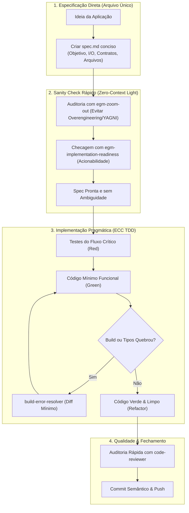

# Guia Rápido de Especificação e Desenvolvimento Ágil (Fast-Track)

Este guia apresenta um processo enxuto e pragmático para especificar e implementar aplicações simples, utilitários, CLIs, automações internas ou MVPs, utilizando os poderes combinados do **EGM (*Elephant-Goldfish Model*)** e do **ECC (*Everything Claude Code*)** no **Antigravity CLI (`agy`)**, **sem a sobrecarga cerimonial** do processo corporativo completo descrito em [`EGM-ECC process.md`](file:///home/willycornelissen/Desktop/Dablio/new-pp/EGM-ECC%20process.md).

---

## 1. Quando usar o Processo Rápido vs. Processo Completo

Nem todo projeto exige múltiplos rounds de brainstorming, redação de dezenas de páginas de Design Doc e um enxame paralelo de 7 subagentes *Goldfish*. Utilize a matriz abaixo para decidir qual caminho seguir:

| Critério | Processo Rápido (`quickstart.md`) | Processo Completo ([`EGM-ECC process.md`](file:///home/willycornelissen/Desktop/Dablio/new-pp/EGM-ECC%20process.md)) |
| :--- | :--- | :--- |
| **Tipo de Aplicação** | Utilitário CLI, microserviço simples, script de dados, webhook, protótipo/MVP, feature isolada. | Sistema distribuído, core bancário/financeiro, refatoração de legado em larga escala, arquitetura multi-serviços. |
| **Complexidade** | 1 a 5 arquivos de código, regras de negócio diretas, poucas integrações externas. | Múltiplos módulos, alta concorrência, migração de bancos relacionais/NoSQL, SLA crítico. |
| **Fase de Concepção** | Especificação em arquivo único (`spec.md`) direto ao ponto. | Brainstorming formal (`egm-brainstorm`) + Design Doc completo (`egm-draft`). |
| **Revisão Imparcial** | *Sanity check* pontual com [`egm-zoom-out`](file:///home/willycornelissen/Desktop/Dablio/new-pp/.agents/plugins/egm/agents/zoom_out.md) e [`egm-implementation-readiness`](file:///home/willycornelissen/Desktop/Dablio/new-pp/.agents/plugins/egm/agents/implementation_readiness.md). | Enxame completo de 7 subagentes em 5 fases orquestrado por [`egm-synthesizer`](file:///home/willycornelissen/Desktop/Dablio/new-pp/.agents/plugins/egm/agents/synthesizer.md). |
| **Ciclo de Testes** | TDD focado no fluxo crítico (*Happy Path* + principais erros). | TDD estrito com cobertura $\ge 80\%$, testes de integração e ponta a ponta ([`e2e-runner`](file:///home/willycornelissen/Desktop/Dablio/new-pp/.agents/agents/e2e-runner.md)). |
| **Auditoria Final** | Auto-revisão via [`code-reviewer`](file:///home/willycornelissen/Desktop/Dablio/new-pp/.agents/agents/code-reviewer.md) ou revisor da linguagem. | Multi-auditoria: segurança OWASP, acessibilidade WCAG, detecção de falhas silenciosas e relatório de deriva. |

---

## 2. Visão Geral do Fluxo Ágil (4 Passos)



---

## 3. Passo a Passo Detalhado

### Passo 1: Especificação Direta em Arquivo Único (`spec.md`)

Para uma aplicação simples, não crie diretórios complexos de documentação preliminar. Crie diretamente um arquivo `spec.md` na raiz ou em `docs/spec.md`.

#### 📋 Template Compacto de `spec.md` (1 Página)

```markdown
# Especificação: [Nome da Aplicação ou Ferramenta]

## 1. Objetivo & Contexto
* **O que faz**: [1 ou 2 frases resumindo a funcionalidade central]
* **Para quem**: [Usuário final, desenvolvedor ou serviço consumidor]
* **O que NÃO faz (Não-Objetivos / Out of Scope)**: [Exclusões explícitas para evitar inflar o escopo]

## 2. Entradas, Saídas e Interfaces (I/O)
* **Entradas**: [Argumentos CLI, variáveis de ambiente (.env), parâmetros de URL ou arquivo JSON]
* **Saídas**: [Saída no terminal (tabela, texto simples), JSON formatado, código de saída (0 ou 1)]
* **Exemplo de Uso**:
  ```bash
  ./meu-app --comando argumento --flag
  ```

## 3. Regras de Negócio & Tratamento de Erros
1. [Regra 1: Ex.: Validar se o parâmetro obrigatório foi informado]
2. [Regra 2: Ex.: Em caso de falha de conexão, retentar 1 vez com timeout de 3s]
3. [Regra 3: Ex.: Retornar mensagem legível amigável no stderr em caso de erro]

## 4. Estrutura Mínima de Arquivos
* `main.go` (ou `index.ts`, `app.py`): Ponto de entrada e parsing de argumentos
* `service.go` (ou `client.ts`): Lógica de negócio e chamadas externas
* `service_test.go`: Testes unitários do fluxo crítico
```

> [!TIP]
> **Prompt para gerar o `spec.md` diretamente:**
> *"Assistente, crie um `spec.md` compacto de 1 página para [sua ideia de aplicação] seguindo o template do `quickstart.md`, focando em simplicidade e definindo claramente entradas, saídas e não-objetivos."*

---

### Passo 2: *Sanity Check* Seletivo com Subagentes EGM

Em vez de acionar a suíte pesada de 5 fases do EGM, selecione apenas **dois subagentes cirúrgicos** em chamadas isoladas:

1. **[`egm-zoom-out`](file:///home/willycornelissen/Desktop/Dablio/new-pp/.agents/plugins/egm/agents/zoom_out.md) — Filtro Anti-Complexidade**:
   * *Pergunta que ele responde*: *"Existe algo nessa especificação que é complexo demais para o objetivo? Estamos reinventando a roda ou violando YAGNI (*You Aren't Gonna Need It*)?"*
   * *Ação*: Remove abstrações precoces, bancos de dados desnecessários ou dependências pesadas.

2. **[`egm-implementation-readiness`](file:///home/willycornelissen/Desktop/Dablio/new-pp/.agents/plugins/egm/agents/implementation_readiness.md) — Filtro de Clareza Executável**:
   * *Pergunta que ele responde*: *"O desenvolvedor consegue codificar isso agora sem ter que inventar decisões de design durante a implementação?"*
   * *Ação*: Garante que entradas, saídas e erros estão especificados sem pontas soltas.

#### Como invocar a validação no chat:
```text
Invoque o subagente 'egm-zoom-out' para auditar o arquivo spec.md sob a ótica de simplicidade e YAGNI.
Em seguida, invoque o 'egm-implementation-readiness' para confirmar se a especificação está pronta para implementação imediata.
```

Se ambos aprovarem (ou se os apontamentos menores forem corrigidos em minutos), o documento está **aprovado para execução**.

---

### Passo 3: Implementação Focada com TDD Enxuto (ECC)

No processo simplificado, o foco do TDD é o **fluxo crítico** (*Happy Path*) e o **caso de erro mais comum**, dispensando montagem prévia de esteiras E2E complexas.

1. **Escrever o Teste Primeiro (Red)**:
   * Crie o arquivo de teste (ex: `service_test.go` ou `service.test.ts`).
   * Teste a função central com uma entrada válida e verifique a saída esperada.
   * Rode o teste e certifique-se de que ele falha pelo motivo correto.
2. **Implementar o Código Mínimo (Green)**:
   * Escreva o código estritamente necessário para fazer o teste passar.
   * Não adicione funcionalidades não cobertas pela especificação.
3. **Resolução Mecânica de Quebras**:
   * Se houver falha de compilação ou de tipos, delegue ao resolver da stack:
     * Para Go: [`go-build-resolver`](file:///home/willycornelissen/Desktop/Dablio/new-pp/.agents/agents/go-build-resolver.md)
     * Para TypeScript/Node: [`build-error-resolver`](file:///home/willycornelissen/Desktop/Dablio/new-pp/.agents/agents/build-error-resolver.md)
     * Para Python: [`django-build-resolver`](file:///home/willycornelissen/Desktop/Dablio/new-pp/.agents/agents/django-build-resolver.md) ou ambiente Python
4. **Refatoração Rápida (Refactor)**:
   * Remova duplicidades e mantenha funções com menos de 50 linhas.

> [!NOTE]
> Você pode solicitar apoio direto ao [`tdd-guide`](file:///home/willycornelissen/Desktop/Dablio/new-pp/.agents/agents/tdd-guide.md) do ECC para conduzir as fases Red $\rightarrow$ Green $\rightarrow$ Refactor.

---

### Passo 4: Auditoria Rápida de Qualidade e Fechamento

Para aplicações simples, basta uma única passagem de revisão:

1. **Revisão de Qualidade com [`code-reviewer`](file:///home/willycornelissen/Desktop/Dablio/new-pp/.agents/agents/code-reviewer.md)**:
   * Analisa legibilidade, manutenibilidade, vazamento de recursos (ex: arquivos abertos sem `defer`/`close`) e ausência de *secrets* no código.
   * Se for uma linguagem específica, você pode optar diretamente pelo revisor nativo:
     * Go: [`go-reviewer`](file:///home/willycornelissen/Desktop/Dablio/new-pp/.agents/agents/go-reviewer.md)
     * TypeScript: [`typescript-reviewer`](file:///home/willycornelissen/Desktop/Dablio/new-pp/.agents/agents/typescript-reviewer.md)
     * Python: [`python-reviewer`](file:///home/willycornelissen/Desktop/Dablio/new-pp/.agents/agents/python-reviewer.md)
2. **Commit Semântico e Push**:
   ```bash
   git add .
   git commit -m "feat: implementa [funcionalidade] conforme spec.md"
   git push origin main
   ```

---

## 4. Exemplo Prático Completo: CLI Utilitária de Cotação de Criptoativos

Abaixo está uma demonstração prática de como aplicar esse fluxo na criação de um utilitário de linha de comando (`crypto-cli`) em poucas etapas.

### 4.1. Passo 1 — O `spec.md` da Aplicação

```markdown
# Especificação: Crypto-CLI

## 1. Objetivo & Contexto
* **O que faz**: Consulta o preço atual e variação em 24h de uma criptomoeda via API pública gratuita (CoinGecko) e exibe no terminal.
* **Para quem**: Desenvolvedores e operadores que precisam checar cotações rapidamente via terminal.
* **O que NÃO faz**: Não armazena histórico em banco de dados, não executa ordens de compra/venda, não requer autenticação.

## 2. Entradas, Saídas e Interfaces
* **Entrada**: Argumento posicional obrigatório com o símbolo/ID da moeda (ex: `bitcoin`, `ethereum`) e flag opcional `--currency` (padrão: `usd`).
* **Saída**: Tabela simples ou texto formatado com: Moeda, Preço Atual, Variação 24h e Data da Consulta.
* **Exemplo de Comando**:
  ```bash
  ./crypto-cli bitcoin --currency brl
  ```

## 3. Regras de Negócio & Tratamento de Erros
1. Se a moeda não for encontrada pela API, retornar mensagem `Erro: moeda '[nome]' não encontrada` e exit code 1.
2. Timeout da chamada HTTP configurado para 5 segundos.
3. Se o serviço estiver indisponível ou ocorrer timeout, retornar `Erro: serviço de cotação indisponível`.

## 4. Estrutura de Arquivos
* `main.go`: Leitura de argumentos da CLI (Cobra ou flag stdlib)
* `client.go`: Chamada HTTP para `https://api.coingecko.com/api/v3/simple/price`
* `client_test.go`: Testes unitários com mock do servidor HTTP
```

### 4.2. Passo 2 — Sanity Check com os Goldfish Selecionados

* **Prompt para o assistente**:
  > *"Acione o `egm-zoom-out` para verificar se há excesso de escopo no `spec.md` acima e o `egm-implementation-readiness` para validar se podemos codificar imediatamente."*

* **Retorno esperado do `egm-zoom-out`**:
  > *"A spec está focada e respeita YAGNI. Não há dependências pesadas nem camadas desnecessárias de repositório ou cache persistente. Aprovado."*

* **Retorno do `egm-implementation-readiness`**:
  > *"Entradas, saídas, códigos de erro e estrutura de arquivos estão perfeitamente especificados. Pronto para implementação."*

### 4.3. Passo 3 — Implementação com TDD Enxuto

1. **Escrever teste unitário (`client_test.go`)**:
   * Simula um servidor de teste (`httptest.NewServer`) retornando JSON de sucesso e erro 404.
2. **Implementar a lógica (`client.go`)**:
   * Struct com cliente HTTP com timeout de 5s e parsing do JSON retornado.
3. **Ponto de entrada (`main.go`)**:
   * Interpretação de flags e impressão no stdout.
4. **Execução dos testes**:
   ```bash
   go test -v ./...
   ```

### 4.4. Passo 4 — Auditoria e Entrega

1. Chamar [`go-reviewer`](file:///home/willycornelissen/Desktop/Dablio/new-pp/.agents/agents/go-reviewer.md) para verificar tratamento de erros e fechamento de `resp.Body`.
2. Commit e push direto:
   ```bash
   git add spec.md main.go client.go client_test.go
   git commit -m "feat: adiciona utilitário crypto-cli com testes"
   git push origin main
   ```

---

## 5. Resumo das Regras de Produtividade

1. **1 Arquivo de Spec Basta**: Se a aplicação tem escopo único, o `spec.md` compacto supre todas as necessidades de documentação preliminar.
2. **Economize Tokens & Tempo**: Não acione enxames inteiros de subagentes para utilitários simples. Utilize apenas `egm-zoom-out` (simplificação) e `egm-implementation-readiness` (prontidão).
3. **TDD Direcionado**: Cubra o caminho feliz e os erros comuns; não perca tempo buscando 100% de cobertura com dezenas de cenários irrelevantes em ferramentas descartáveis ou utilitárias.
4. **Evolução Gradual**: Se a aplicação simples crescer e se tornar um sistema central, faça a migração para o processo corporativo de [`EGM-ECC process.md`](file:///home/willycornelissen/Desktop/Dablio/new-pp/EGM-ECC%20process.md).
